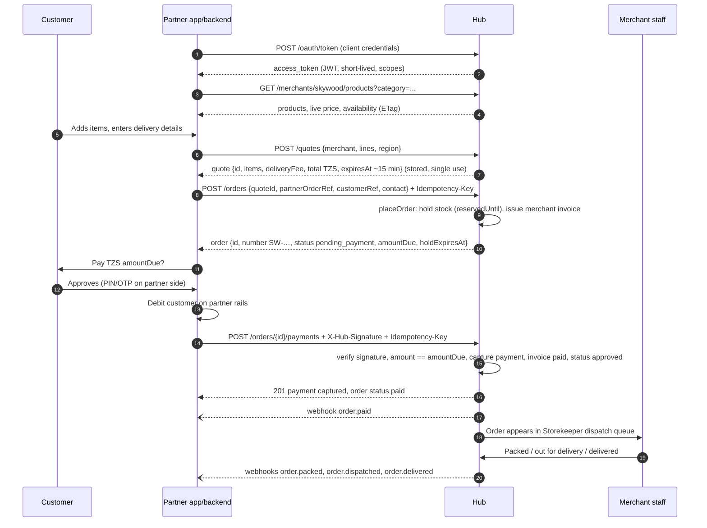
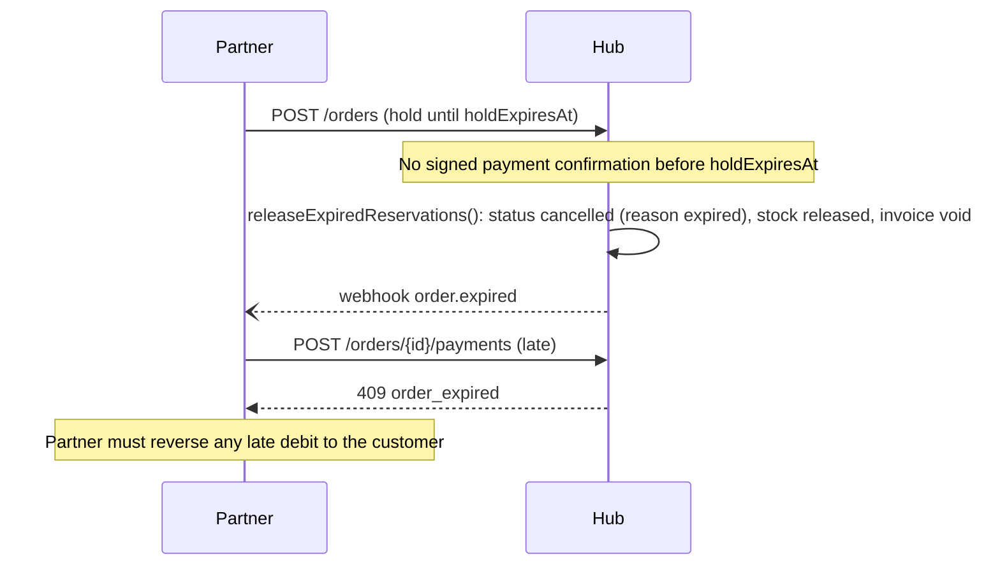
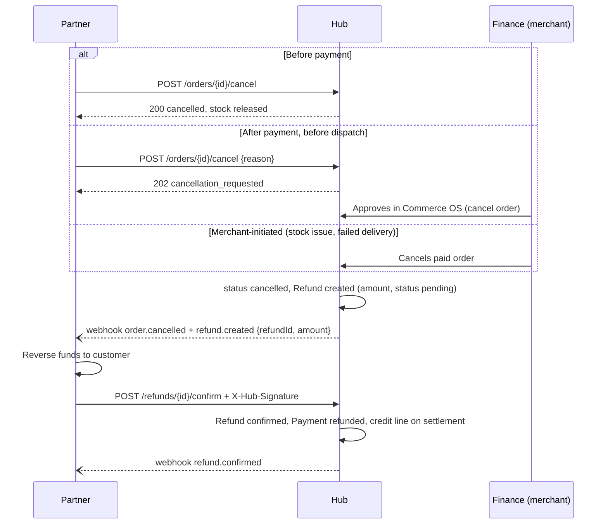
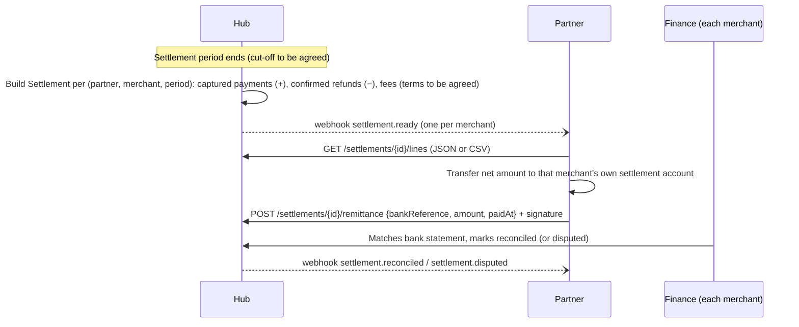
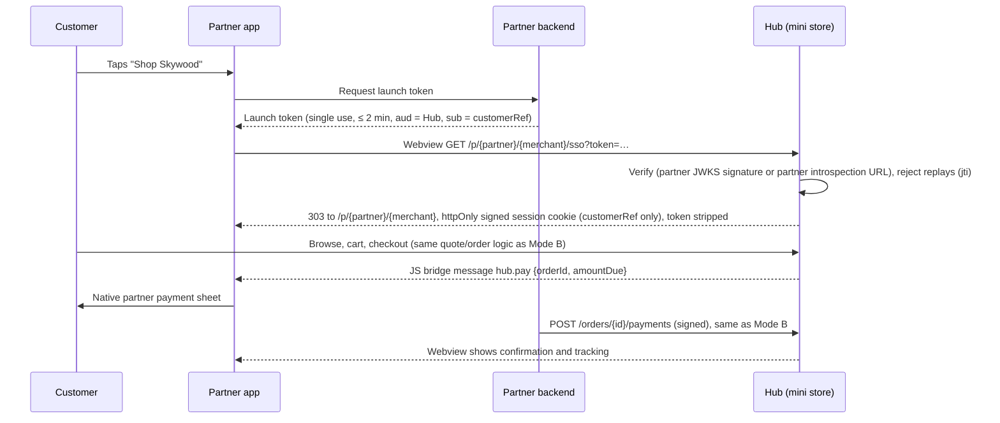

# Partner Commerce API (v1): design

Status: **draft for client review**. Design only; nothing here is built yet.
Companion documents: `docs/api/openapi.yaml` (contract), `docs/api/PARTNER-QUICKSTART.md` (developer guide), `docs/security/PARTNER-API-SECURITY.md` (authentication, signing, threat model; that document is authoritative on security details).

---

## 1. Summary for management

**What it is.** Banks, wallets and super-apps ("partners", for example Azania Bank) can sell Mr UK and Skywood products to their own customers inside their own apps. The partner collects the money on its own rails (account debit, wallet). Our platform (the **Hub**) does everything else: catalogue, prices, stock, the order, the merchant's invoice, dispatch, delivery tracking and the audit trail.

**Two ways to connect, one backend.**

| Mode | What the partner builds | Effort for the partner | Example |
|---|---|---|---|
| **A. Mini store** | Nothing but a button: their app opens our hosted store in a webview and the customer is signed in automatically (SSO). | Low (days) | The existing Azania mini app, generalised to any partner |
| **B. Headless API** | Their own native screens, calling our REST API for products, quotes, orders and payment confirmation. | Medium (weeks) | A super-app with its own shopping UI |

Both modes create the same orders in the same queues; staff work exactly as today.

**Two merchants stay separate end to end.** Mr UK and Skywood are separate legal entities. In the API:
- every catalogue call, quote and order belongs to **one merchant** (no mixed baskets);
- order numbers stay per merchant (`MU-…`, `SW-…`), and invoices are issued in **the merchant's name**, numbered **per merchant** (a change: today one `INV-` series is shared, see §6);
- stock is held and released per merchant;
- money is settled by the partner **directly into each merchant's own bank account**, with a separate settlement report per merchant;
- a partner is granted access **per merchant** (it can be allowed to sell Skywood but not Mr UK), each grant with its own terms and enabled payment rails;
- staff of one merchant see only that merchant's partner orders and settlements (existing per-brand scopes).

**The Hub is the single executor.** Partners never change stock, prices or order status directly; they make requests, and the Hub applies the same rules (state machine, stock holds, audit log) as for web orders.

**What partners never send us.** Account numbers, PINs, balances or KYC files. We receive only what delivery needs: name, phone, delivery address, and the partner's customer reference (Tanzania PDPA 2022, data minimisation).

---

## 2. Actors and environments

| Actor | Role |
|---|---|
| Customer | Shops in the partner's app. |
| Partner | Organisation with credentials per environment and grants per merchant. Collects payment, reverses refunds, settles to merchants. |
| Hub | This Commerce OS (`apps/web` + `apps/admin` codebase). Executes catalogue, quotes, orders, holds, invoices, dispatch, webhooks, settlement reports. |
| Merchant | Mr UK (`mruk`) or Skywood (`skywood`). Merchant of record: sells, invoices, ships, receives settlement. |
| Staff | Commerce OS users (Order desk, Finance, Storekeeper, Management, Admin). |

| | Sandbox | Live |
|---|---|---|
| Base URL | `https://sandbox.partners.<hub-domain>/api/partner/v1` | `https://partners.<hub-domain>/api/partner/v1` |
| Credentials | Sandbox client id/secret and signing secret | Separate set, issued only after go-live approval |
| Deployment | Separate deployment and database | Production |
| Catalogue | Nightly copy of the live catalogue (real products, prices, photos) | Live |
| Stock | Simulated; real stock never moves | Real holds and decrements |
| Payments | No money moves; any correctly signed confirmation is accepted | Partner's real rails |
| Fulfilment | Automatic progression, or driven with `POST /sandbox/orders/{id}/simulate` | Staff in the Commerce OS |
| mTLS | Not required | Optional per partner (recommended) |

`<hub-domain>` is to be agreed with the client. A separate sandbox deployment means no `livemode` flag is needed in the production database and test orders can never reach staff queues.

---

## 3. End-to-end flows

### 3.1 Browse → quote → order → payment → fulfilment (Mode B)



### 3.2 Unpaid order expires



Partners should debit and confirm only while `holdExpiresAt` is in the future and should not debit the customer within the last 60 seconds of the hold.

### 3.3 Cancellation and refund



Returns after delivery and partial refunds are **business rules not yet agreed** (§10). Until agreed, refunds are full-order only and initiated by Finance.

### 3.4 Settlement and reconciliation



### 3.5 Mode A: mini store SSO (generalised from Azania)

Today `/azania/sso?token=…` exchanges a bank token through `integrations.bank.verifySsoToken`, then sets a short-lived signed `bt_azania` cookie holding only `customerRef`. The generalised version keeps that design per partner.



The Azania mini app becomes the first instance (`/azania` stays as an alias). Partner KYC (name, phone) may prefill the delivery form, but the Hub stores only what the order needs.

---

## 4. API reference

### 4.1 Conventions

| Topic | Rule |
|---|---|
| Transport | HTTPS only (TLS 1.2+), JSON UTF-8. Optional mTLS in live. |
| Auth | OAuth 2.0 client credentials: `POST /oauth/token` returns an ES256-signed JWT access token (10 min, no refresh token). Header `Authorization: Bearer <token>`. |
| Scopes | `catalog:read`, `orders:read`, `orders:write`, `payments:write`, `refunds:write`, `settlements:read`, `webhooks:manage`. |
| Merchant grants | A token works only for merchants the partner is granted. Ungranted merchant: `404 merchant_not_found` (no existence leak). |
| Idempotency | `Idempotency-Key` (UUID, ≤ 64 chars) **required on every POST**. |
| Signing | Payment, refund and remittance confirmations carry `X-Hub-Signature: t=<unix>,v1=<hex HMAC-SHA256(secret, t + "." + rawBody)>` using the partner's signing secret. Rejected if `t` is more than 5 minutes from Hub time. |
| Money | Integer TZS (no decimals), always with `"currency": "TZS"`. |
| Time | RFC 3339 UTC (`2026-11-27T09:30:00Z`). |
| Phone | E.164 Tanzanian `+255…` (same validation as checkout). |
| IDs | Hub ids are opaque strings. Orders also have a human `number` (`MU-10483`). Partners send their own `partnerOrderRef` (unique per partner). |
| Tracing | `X-Request-Id` returned on every response (partners may send their own). |
| Rate limits | Per partner, per environment, per scope group. `429` with `Retry-After`; `RateLimit-Limit/Remaining/Reset` headers. Defaults to agree per partner: catalogue 600/min, quote 120/min, order create 60/min, payment 60/min, token 30/min. Hold caps (open unpaid orders, held units per product) return `429 hold_limit`. |

### 4.2 Endpoints

| Method | Path | Scope | Purpose |
|---|---|---|---|
| POST | `/oauth/token` | client auth | Issue access token |
| GET | `/merchants` | catalog:read | Merchants this partner may sell |
| GET | `/merchants/{merchant}/categories` | catalog:read | Categories and subcategories |
| GET | `/merchants/{merchant}/products` | catalog:read | Product list (cursor, filters) |
| GET | `/merchants/{merchant}/products/{productId}` | catalog:read | Product detail with ETag |
| GET | `/merchants/{merchant}/delivery-regions` | catalog:read | Regions, fee rule, ETA |
| POST | `/quotes` | orders:write | Price a cart for one merchant (≈15 min validity) |
| POST | `/orders` | orders:write | Create order from quote; holds stock |
| GET | `/orders` | orders:read | List own orders (cursor, status, merchant, updatedSince) |
| GET | `/orders/{orderId}` | orders:read | Order with items, status, payments, refunds |
| POST | `/orders/{orderId}/cancel` | orders:write | Cancel unpaid order, or request cancellation of a paid one |
| POST | `/orders/{orderId}/payments` | payments:write + signature | Confirm payment collected by partner |
| GET | `/orders/{orderId}/invoice` | orders:read | Merchant invoice PDF |
| GET | `/refunds` | orders:read | List refunds |
| GET | `/refunds/{refundId}` | orders:read | Refund detail |
| POST | `/refunds/{refundId}/confirm` | refunds:write + signature | Confirm money returned to customer |
| GET | `/settlements` | settlements:read | Settlements per merchant and period |
| GET | `/settlements/{settlementId}` | settlements:read | Totals |
| GET | `/settlements/{settlementId}/lines` | settlements:read | Line items (JSON, or CSV with `Accept: text/csv`) |
| POST | `/settlements/{settlementId}/remittance` | payments:write + signature | Report the bank transfer made to the merchant |
| GET | `/events` | orders:read | Event feed (same payloads as webhooks), for catch-up |
| GET, POST | `/webhook-endpoints` | webhooks:manage | List / register endpoints |
| PATCH, DELETE | `/webhook-endpoints/{endpointId}` | webhooks:manage | Update events/URL, disable, remove |
| POST | `/webhook-endpoints/{endpointId}/test` | webhooks:manage | Send a `ping` event |
| GET | `/webhook-deliveries` | webhooks:manage | Delivery log (status, attempts, response code) |
| POST | `/webhook-deliveries/{deliveryId}/redeliver` | webhooks:manage | Retry a delivery |
| POST | `/sandbox/orders/{orderId}/simulate` | orders:write (sandbox only) | Drive `pack`, `dispatch`, `deliver`, `cancel`, `expire`; `404` in live |

### 4.3 Pagination, filtering, caching

- **Cursor pagination**: `?limit=` (1–100, default 50) and `?cursor=`. Responses are `{ "data": [...], "nextCursor": "…" | null }`. Cursors are opaque and stable under inserts.
- **Filters**: products `category`, `sub`, `q`, `inStock`, `updatedSince`; orders `merchant`, `status`, `updatedSince`, `partnerOrderRef`; settlements `merchant`, `status`, `from`, `to`.
- **Catalogue caching**: product list and detail return `ETag` and `Cache-Control: private, max-age=60`. Send `If-None-Match` to get `304`. Use `updatedSince` for incremental sync; hidden products appear once with `"available": false` so partners can remove them. Prices and availability are **indicative**; only a quote is binding.

### 4.4 Errors (RFC 7807)

`Content-Type: application/problem+json`:

```json
{ "type": "https://partners.<hub-domain>/problems/amount_mismatch",
  "title": "Amount does not match amount due", "status": 422, "code": "amount_mismatch",
  "detail": "Expected 1450000 TZS.", "instance": "/api/partner/v1/orders/ord_7Q/payments",
  "requestId": "req_01J…", "errors": [] }
```

| Code | HTTP | Meaning |
|---|---|---|
| `invalid_request` | 400 | Schema/Zod validation failed (`errors[]` lists fields) |
| `invalid_client` / `invalid_token` | 401 | Bad credentials / expired or revoked token |
| `insufficient_scope` | 403 | Token lacks scope |
| `invalid_signature` / `signature_expired` | 401 | `X-Hub-Signature` wrong / outside 5-minute window |
| `merchant_not_found`, `product_not_found`, `order_not_found`, `refund_not_found`, `settlement_not_found` | 404 | Unknown or not granted to this partner |
| `order_not_cancellable` | 409 | Already dispatched, delivered or closed |
| `idempotency_mismatch` | 422 | Same key, different body |
| `idempotency_in_progress` | 409 | Same key still processing |
| `quote_expired` | 410 | Re-quote |
| `quote_stale` | 409 | Live price or stock changed since the quote; re-quote |
| `out_of_stock` | 409 | Line no longer available (`errors[]` names product) |
| `region_not_served` | 422 | Delivery region not supported |
| `order_expired` | 409 | Hold expired; partner must reverse the debit |
| `order_not_payable` | 409 | Order cancelled or already paid |
| `amount_mismatch` / `currency_mismatch` | 422 | Payment must equal `amountDue` in TZS |
| `duplicate_partner_reference` | 409 | `partnerOrderRef` or `partnerTransactionRef` already used |
| `rail_not_enabled` | 422 | Payment rail not enabled for this merchant grant |
| `rate_limited`, `hold_limit` | 429 | Slow down (`Retry-After`) / too many open holds |
| `internal_error` | 500 | Hub fault; safe to retry with same Idempotency-Key |

### 4.5 Versioning and deprecation

- Major version in the path (`/v1`). Additive changes (new fields, endpoints, event types, enum values flagged as extensible) are non-breaking; partners must ignore unknown fields and events.
- Breaking changes ship as `/v2`. `v1` keeps working for at least **12 months** after `v2` (proposed default, to be agreed), with `Deprecation` and `Sunset` headers and email notice to each partner's technical contact.

### 4.6 Idempotency semantics

- Key scope: (partner, key); sandbox and live are separate deployments. Missing key: `400`. Stored 24 hours with a hash of method, path and body; insert-first so concurrent duplicates are detected.
- Same key and body: the original status and body are replayed (header `Idempotent-Replayed: true`). Same key, different body: `422 idempotency_mismatch`. Concurrent duplicate: `409`.
- Natural keys back this up: `partnerOrderRef` is unique per partner; `partnerTransactionRef` is unique per partner. A payment confirmation repeated with a new key but the same transaction ref returns the existing payment, never a second capture.

### 4.7 States

Partner-facing states are a stable projection of the core state machine (`packages/core/src/orders.ts`); the core is unchanged except for a new payment method value.

| API `order.status` | Core status | Notes |
|---|---|---|
| `pending_payment` | `placed` with `reservedUntil` | Stock held until `holdExpiresAt` |
| `paid` | `approved` | Payment captured; in dispatch queue. Partner-paid orders skip the phone confirmation step (`initialOrderStatus(captured)`), unless the merchant enables it, in which case the core status is `confirmed` and the API still shows `paid` |
| `packed` | `packed` | |
| `dispatched` | `out_for_delivery` | |
| `delivered` | `delivered` | Terminal |
| `cancellation_requested` | `approved`/`packed` plus open cancellation request | Awaiting Finance |
| `cancelled` | `cancelled` | Terminal; a refund is created if money was captured |
| `expired` | `cancelled` with reason `expired` | Terminal; never paid |

Payment (`Payment.status`): `captured` → `refunded`. Partner payments are recorded as captured only after a valid signed confirmation, so there is no `pending` payment row for partner orders. Refund: `pending` (Hub instructed the partner) → `confirmed` (partner returned funds); `failed` if the partner reports it cannot reverse (escalated to Finance).

Invoice: issued (merchant's name, per-merchant number) at order creation → `paid` on payment → `void` on expiry or cancellation.

### 4.8 Webhooks

Delivery: `POST` JSON to each registered HTTPS endpoint (public addresses only, no redirects; live URLs approved by Bermi Techs). Headers: `X-Hub-Signature` (same scheme as above, with the partner's signing secret), `X-Hub-Event`, `X-Hub-Delivery` (unique id), `X-Request-Id`. Body:

```json
{ "id": "evt_01J…", "type": "order.paid", "createdAt": "2026-11-27T09:31:02Z",
  "merchant": "skywood", "data": { "order": { "id": "ord_7Q…", "number": "SW-20391", "status": "paid", "version": 3 } } }
```

| Event | When |
|---|---|
| `order.created` | Order created (also by Mode A checkout) |
| `order.paid` | Payment captured |
| `order.packed`, `order.dispatched`, `order.delivered` | Fulfilment progress |
| `order.cancellation_requested` | Partner request recorded |
| `order.cancelled` | Cancelled (by partner before payment, or by merchant) |
| `order.expired` | Hold expired unpaid |
| `refund.created` | Partner must return `amount` to the customer |
| `refund.confirmed`, `refund.failed` | Refund outcome recorded |
| `settlement.ready` | Period closed for one merchant |
| `settlement.reconciled`, `settlement.disputed` | Finance outcome |
| `ping` | Test delivery |

Rules: respond `2xx` within 5 s; anything else is retried with exponential backoff and jitter (≈ 1 min, 5 min, 15 min, 1 h, then every 3 h) for up to **24 hours**, then dead-lettered (admin and partner can redeliver) and the partner's technical contact and Bermi support are alerted. Payloads carry ids, statuses and amounts, no customer PII beyond `partnerCustomerRef`. Delivery is **at least once** and **unordered**: deduplicate by `id`, and use `data.order.version` (monotonic per order) or `GET /orders/{id}` to ignore stale events. `GET /events` replays the last 30 days.

---

## 5. Integration with existing code

- `placeOrder()` gains a partner entry point: `channel = "partner"`, `paymentMethod = "partner"`, hold length per grant (default 15 minutes, aligned to quote expiry; web orders keep the existing 30-minute `RESERVATION_MINUTES`). It already holds stock, honours "never charge more than was shown" (the quote price) and issues the invoice.
- `capturePayment()` gets a partner variant that takes the verified confirmation instead of card/account details, then performs the same `placed → approved` update guarded by status.
- `releaseExpiredReservations()` already cancels expired holds; it additionally records reason `expired` and emits `order.expired`.
- `transitionOrder()` calls a new `emitPartnerEvent()` on every status change of a partner order; delivery runs from the existing cron route (`apps/web/src/app/api/cron`).
- `limit()` (`server/ratelimit.ts`) and `audit()` (`server/audit.ts`) are reused; every partner call that changes state writes an `AuditLog` row with actor `partner:<id>`.
- Quotes are **stored and single use** (`PartnerQuote`, see security doc C6): `POST /orders` takes prices only from the stored quote and re-checks live price and stock (`409 quote_stale` if they changed).

---

## 6. Data model changes (Prisma, minimal)

```prisma
model Partner {            // a bank, wallet or super-app
  id String @id @default(cuid())
  slug String @unique      // "azania"
  name String
  status String            // onboarding | sandbox | live | suspended
  techContactEmail String
  ssoMode String?          // jwks | introspection (Mode A)
  ssoConfig Json?          // JWKS URL or introspection URL (no secrets)
  createdAt DateTime @default(now())
  credentials PartnerCredential[]
  grants PartnerMerchantGrant[]
  endpoints PartnerWebhookEndpoint[]
}
model PartnerCredential {  // one active + one rotating per environment
  id String @id @default(cuid())
  partnerId String
  clientId String @unique
  secretHash String        // argon2id; shown once at creation
  signingSecretEnc String  // encrypted at rest (needed to verify HMAC)
  scopes String[]
  mtlsCertFingerprint String?
  allowedIps String[]
  status String            // active | rotating | revoked
  expiresAt DateTime?
  lastUsedAt DateTime?
  createdAt DateTime @default(now())
}
model PartnerMerchantGrant { // per-merchant permission and terms
  id String @id @default(cuid())
  partnerId String
  brandKey String
  enabled Boolean @default(false)
  modes String[]           // mini_store | api
  rails String[]           // bank_account | wallet | card (wallet = mobile money: client approval needed)
  holdMinutes Int @default(15)
  requirePhoneConfirm Boolean @default(false)
  feeTerms Json?           // to be agreed; null = none applied
  @@unique([partnerId, brandKey])
}
model PartnerWebhookEndpoint {
  id String @id @default(cuid())
  partnerId String
  url String
  events String[]
  status String            // active | disabled (signed with the partner's signing secret)
  failingSince DateTime?
}
model WebhookDelivery {
  id String @id @default(cuid())
  endpointId String
  eventId String
  eventType String
  payload Json             // no PII beyond order snapshot fields
  attempts Int @default(0)
  nextAttemptAt DateTime?
  lastStatus Int?
  deliveredAt DateTime?
  createdAt DateTime @default(now())
  @@index([nextAttemptAt])
}
model PartnerQuote {       // binding price, single use, ~15 min
  id String @id @default(cuid())
  partnerId String
  brandKey String
  region String
  lines Json               // productId, qty, unitPrice
  deliveryFee Int
  total Int
  contentHash String
  expiresAt DateTime
  usedAt DateTime?
  @@index([expiresAt])
}
model Refund {
  id String @id @default(cuid())
  orderId String
  amount Int
  status String            // pending | confirmed | failed
  reason String
  partnerRefundRef String?
  confirmedAt DateTime?
  createdAt DateTime @default(now())
}
model Settlement {
  id String @id @default(cuid())
  partnerId String
  brandKey String          // one merchant per settlement
  periodStart DateTime
  periodEnd DateTime
  gross Int
  refunds Int
  fees Int
  net Int
  status String            // open | ready | remitted | reconciled | disputed
  bankReference String?
  remittedAt DateTime?
  reconciledBy String?
  lines SettlementLine[]
  @@unique([partnerId, brandKey, periodStart])
}
model SettlementLine {
  id String @id @default(cuid())
  settlementId String
  kind String              // payment | refund | fee
  orderId String
  amount Int               // signed TZS
  reference String         // partnerTransactionRef / partnerRefundRef
  at DateTime
}
model IdempotencyRecord {  // = PartnerIdempotency in the security doc
  partnerId String
  key String
  method String
  path String
  requestHash String
  status String            // in_progress | done
  responseCode Int?
  responseBody Json?
  createdAt DateTime @default(now())
  @@id([partnerId, key])
  @@index([createdAt])
}
```

Fields on existing models:
- `Order`: `partnerId String?`, `partnerOrderRef String?`, `partnerCustomerRef String?`, `cancelReason String?`; `@@unique([partnerId, partnerOrderRef])`. Why: link, deduplicate and report without a join table.
- `Payment`: `partnerId String?`, `partnerTransactionRef String?`, `rail String?`, `paidAt DateTime?`; `@@unique([partnerId, partnerTransactionRef])`. Why: one capture per partner transaction; reconciliation key.
- `Brand`: `settlementAccount Json?` (encrypted; shown masked in the API). Why: each merchant's own account for its settlements.
- `Invoice` numbering: counter key per brand (`INV-MU-2026-00001`, `INV-SW-…`). Why: two legal entities must not share one invoice series.

Why no environment column: sandbox is a separate deployment.

---

## 7. Commerce OS admin additions

New **Partners** section (new permissions `partners`, `partners.write`, `partners.keys`, `settlements`, `settlements.write`):

| Screen / action | Who (role id) |
|---|---|
| Onboard partner, contacts, SSO config, status | Admin (`owner`) |
| Create, rotate (overlap window), revoke credentials; secrets shown once | Admin (`owner`) |
| Merchant grants (enable merchant, modes, rails, hold minutes, terms) | Management (`manager`) proposes, Admin applies |
| Promote sandbox → live (checklist must be complete; two-person approval) | Management + Admin |
| Webhook endpoints and delivery log, redeliver | Admin, IT and website (`website`) |
| Partner orders (badge on existing order queues; filters by partner) | Order desk, Storekeeper, Finance (existing screens) |
| Cancellation requests and refunds | Finance (`finance`) |
| Settlement reports per merchant, mark reconciled or disputed, CSV export | Finance (per-brand scope) |
| API usage and error dashboard | Admin, IT and website |

All partner admin mutations write `AuditLog` entries.

---

## 8. Partner onboarding checklist

1. **Legal**: partner agreement with each merchant it will sell (commercial terms, settlement timing, refund and returns responsibility, liability), and a **data processing agreement** under PDPA 2022 (roles, purpose, retention, breach notice, cross-border transfer).
2. **Regulatory**: confirm the payment rail; mobile-money or wallet rails need client approval (out of this contract's scope) and the partner's own regulatory cover.
3. **Technical setup**: technical and security contacts, IP ranges, webhook URLs, SSO method (Mode A), optional mTLS certificate.
4. **Sandbox credentials** issued; partner completes the **test plan**: token; catalogue sync with ETag; quote; order; idempotent retry; signed payment; amount mismatch rejected; expiry; cancellation before and after payment; refund confirmation; webhook signature verification and deduplication; settlement download and remittance; rate-limit handling.
5. **Security review**: per `docs/security/PARTNER-API-SECURITY.md` (secret storage, key rotation drill).
6. **Go-live criteria**: test plan passed with evidence (request ids), agreements signed, merchant settlement accounts confirmed in writing by each merchant's Finance, monitoring contacts set, Management and Admin approve promotion.
7. **Live**: live credentials issued; first-week pilot with a small customer group and daily reconciliation.

---

## 9. Build plan

| # | Milestone | Effort (days) | Reuses |
|---|---|---|---|
| 1 | Schema migration, Partner admin (onboard, credentials, grants) | 3 | Admin layout, RBAC, audit |
| 2 | Token endpoint, JWT verification middleware, scopes, rate limits, problem+json | 2 | `ratelimit.ts`, Zod |
| 3 | Catalogue endpoints with ETag and cursors | 2 | `server/catalog.ts` |
| 4 | Quotes, orders, idempotency, cancel | 3 | `placeOrder`, stock holds, invoices |
| 5 | Signed payment confirmation, refunds | 3 | `capturePayment`, `transitionOrder` |
| 6 | Webhooks (outbox, delivery cron, log, redeliver), `/events` | 3 | cron route, task events |
| 7 | Settlements, remittance, Finance reconciliation screen, CSV | 3 | reports |
| 8 | Mode A generalisation (partner SSO, JS bridge payment) | 3 | Azania mini app |
| 9 | Sandbox deployment, catalogue copy job, simulate endpoint | 2 | deploy scripts |
| 10 | OpenAPI-driven contract tests, e2e (order, expiry, refund, settlement), security tests, docs | 4 | Playwright, Vitest |
| | **Total** | **≈ 28** | |

Estimates assume one engineer and exclude partner-side work and legal time.

## 10. Open questions for the client

1. **Commercial terms** per partner and merchant: commission or fees, who pays them, invoiced or netted on settlement (to be agreed).
2. **Settlement timing and cut-off** (for example daily, T+1) and the bank accounts for each merchant (to be agreed).
3. **Returns and refunds**: who accepts returns after delivery, partial refunds, refund deadlines, who bears reversal costs.
4. **Mobile money / wallet rails**: approve or exclude for this phase (out of current contract scope).
5. **TRA EFD/VFD**: out of scope; confirm receipts stay manual. An adapter hook will be left on invoice issue.
6. Should partner-paid orders still get an Order desk phone call (per merchant switch, default off)?
7. Hold time for partner orders (default 15 minutes, versus 30 for web) and quote validity (default 15 minutes).
8. Delivery: do partners only pass the Hub's delivery fee, or may they subsidise it?
9. Customer support: who handles the customer's first contact for partner orders (partner or merchant)?
10. Hub domain names for the partner API (sandbox and live).
