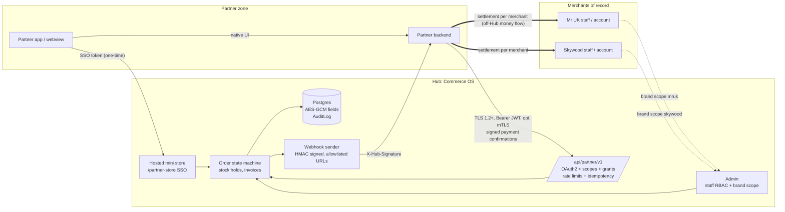

# Partner Commerce API: security design

Status: **design, not built.** Companion to `docs/api/PARTNER-API.md` and `openapi.yaml`, which define the
endpoints. This document defines the security mechanisms those endpoints rely on. Where the two disagree,
raise it in the phase report; do not pick silently. Legal and regulatory points are marked **confirm with
counsel**. Commercial terms (fees, settlement days) are configurable defaults to be agreed, never fixed here.

## 1. Objectives and trust boundaries

**Objectives**
1. **No order is paid unless the partner proves it collected exactly the amount due**, in TZS, once.
2. **Strict tenant isolation:** a partner sees only its own orders and only the merchants it is granted;
   Mr UK and Skywood data, prices, stock and money never mix.
3. **The Hub never holds customer funds or bank data.** The partner collects; the partner settles to each
   merchant's own account.
4. **Partners cannot exhaust stock or capacity** (holds, scraping, request floods).
5. **Every partner call and staff action is attributable** (audit) without PII in logs.
6. **Compromise is containable:** any key can be revoked in minutes without affecting other partners.

**Actors and boundaries**

| Zone | Who | Trust |
|---|---|---|
| Partner backend | Bank / wallet / super-app servers | Authenticated, untrusted input; scoped by grants |
| Partner app / webview | End customer's device | Untrusted; never holds Hub credentials |
| Hub (apps/web, Postgres) | Bermi Techs operates | Trusted core; single codebase |
| Merchant staff | Mr UK / Skywood staff in admin | Trusted per role and brand scope (`packages/core/src/roles.ts`) |
| Merchant bank accounts | Mr UK, Skywood (separate entities) | Outside the Hub; receive settlement from partner |

Boundary rules: data crosses Partner→Hub only through `/api/partner/v1` or the mini-store SSO; money
never crosses into the Hub; staff access is always filtered by brand scope.

## 2. Threat model (STRIDE)

S = Spoofing, T = Tampering, R = Repudiation, I = Information disclosure, D = Denial of service, E = Elevation of privilege.

| # | Threat | STRIDE | Impact | Controls (section 3) |
|---|---|---|---|---|
| T1 | Client secret or signing secret stolen/leaked (repo, logs, partner breach) | S, E | Attacker places/pays orders as partner | C1, C2, C3, C12, C14 |
| T2 | Access token replay / theft | S | Calls within token life | C3, C5 (mTLS binding), short TTL |
| T3 | Forged payment confirmation (no money collected) | S, T | Goods shipped unpaid | C7, C1 |
| T4 | Amount/currency tampering (pay 1 TZS for 3,000,000 TZS order) | T | Loss | C6, C7 |
| T5 | Double-spend / duplicate orders / double capture / double refund | T | Stock and money errors | C8, C7, state machine |
| T6 | IDOR across partners (read/pay/cancel another partner's order) | I, E | Data leak, hijack | C4, C10 tests |
| T7 | Cross-merchant leak (Skywood data via Mr UK grant, mixed quote) | I, E | Legal and commercial breach | C4, one-merchant-per-quote |
| T8 | Webhook spoofing to partner / spoofed inbound "webhooks" | S | Partner acts on fake events | C11 |
| T9 | SSRF via partner-configured webhook URL | E, I | Hub reaches internal network/metadata | C11 |
| T10 | Catalogue scraping / price harvesting | I, D | Commercial loss, load | C9 |
| T11 | Stock-hold DoS (unpaid orders lock all stock) | D | Merchant cannot sell | C9 hold caps |
| T12 | Mass assignment (client sets `status`, `total`, `brandKey`, `partnerId`) | T, E | Free goods, cross-tenant writes | C6, strict Zod schemas |
| T13 | Injection (SQL, header, log, CSV/PDF injection via names/addresses) | T | Data integrity, staff compromise | C6 |
| T14 | Insider misuse (staff marks paid, edits grants, issues fake refund) | T, R, E | Fraud | C13, C12 |
| T15 | PII leakage in logs, errors, webhooks, URLs | I | PDPA breach | C12, section 4 |
| T16 | Sandbox→live confusion (test credentials or fake payments reaching live) | S, T | Unpaid live dispatch | C5 |
| T17 | Mini-app SSO token theft (URL leak, replay), clickjacking in webview | S | Session takeover | C15 |
| T18 | Repudiation by partner ("we never confirmed that payment") | R | Disputes | C7 (signed, stored), C12 |

## 3. Controls

### C1. Credentials and secret storage
- **Per partner, per environment:** `client_id` (public, prefixed `ptn_test_` / `ptn_live_`), `client_secret`
  (shown once at creation), **signing secret** (HMAC, shown once), optional mTLS client certificate.
- **Client secret:** stored only as an **argon2id** hash (memory ≥ 64 MiB, t ≥ 3; bcrypt cost ≥ 12 acceptable if
  argon2 is unavailable on the runtime). Never retrievable. Compare via the library's verify (constant time).
- **Signing secret:** must be usable for HMAC, so it cannot be hashed. Store encrypted with **AES-256-GCM**
  using the existing field-encryption helper (`packages/db/src/crypto.ts`) under a dedicated key
  (`PARTNER_SECRET_KEY`, env/KMS; separate from the NIDA/salary key). Decrypt only in the verify/sign path;
  cache decrypted value in memory ≤ 5 min.
- Secrets have ≥ 256 bits of entropy (32 random bytes, base64url). Hub-side token signing keys (C3) live in
  env/KMS, never in the database.
- Admin UI never displays a secret after creation; "reveal" is replaced by "rotate".

### C2. Rotation and revocation
- Each partner may hold **two active client secrets and two active signing secrets** (overlap for rotation).
  Default overlap 7 days (configurable); old one then auto-expires. Webhooks are signed with the newest
  secret; during overlap the Hub sends one `v1=` per active secret (`t=…,v1=<new>,v1=<old>`), and accepts
  inbound confirmations matching any active secret.
- **Revoke** (Security role + second approver for live): disables the secret immediately; all access tokens
  of that partner are invalidated by bumping a `tokenEpoch` on the partner record (checked on every request,
  see C3). Partner **suspend** switch blocks all calls and the mini store, keeps data.
- Rotate on schedule (default yearly), on staff turnover at the partner, and on any suspected leak.

### C3. OAuth2 client credentials and access tokens
- `POST /api/partner/v1/oauth/token`, `grant_type=client_credentials`, client authenticated by HTTP Basic or
  `client_secret_post`; with mTLS on live, the certificate fingerprint must also match (C5).
- Rate limit the token endpoint per `client_id` and per source IP (e.g. 30/min); 5 consecutive failures per
  client → 15-min lockout and alert. Generic `invalid_client` error (no hint which part failed).
- **Access token:** JWT, **ES256** (asymmetric, `kid` header for key rotation), TTL **10 minutes**, no refresh
  token. Claims: `iss` (Hub), `aud` = `partner-api:<env>`, `sub` = partner id, `env` = `sandbox|live`,
  `scope`, `epoch`, `jti`, `iat`, `exp`, and `cnf.x5t#S256` when mTLS is used.
- Verification on every request: pinned algorithm (reject `none`/HS*), `kid` known, `exp`/`iat` with ≤ 60 s
  skew, `aud` equals this deployment's environment, partner active, `epoch` equals current `tokenEpoch`.
- Requested scopes are intersected with the scopes granted to the partner. **Merchant grants are not put in
  the token**; they are read from the database per request (cached ≤ 60 s) so revocation is fast.

### C4. Authorisation: scopes, merchant grants, tenant isolation
- Scopes: `catalog:read`, `orders:read`, `orders:write`, `payments:write`, `refunds:write`,
  `settlements:read`, `webhooks:manage`. Each route declares one required scope; missing → 403.
- **Grant check on every query:** a single helper builds the base filter
  `{ partnerId: ctx.partnerId, brandKey: { in: ctx.grantedMerchants }, testMode: ctx.env === 'sandbox' }`
  and every partner repository call must use it (lint rule or code review checklist: no raw `prisma.order`
  in partner routes). Order lookups are by `(partnerId, id)`, never by `number` alone.
- Data model additions (design): `Order.partnerId`, `Order.partnerCustomerRef`, `Order.testMode`; `Partner`,
  `PartnerCredential`, `PartnerMerchantGrant(partnerId, brandKey, enabled, paymentModes, feesConfig)`.
- Not found and not yours return the **same 404** (no existence oracle).
- **One merchant per quote and order;** a quote containing products from two brands is rejected.
- Catalogue responses include only granted merchants and non-hidden products.

### C5. Environments and optional mTLS
- Separate base URLs (`sandbox` and `live` hosts), separate credentials, token `aud`/`env` claim checked
  against the host; a sandbox token on live (or vice versa) → 401.
- Sandbox orders: `testMode = true`, never enter merchant dispatch queues, never move real stock, never appear
  in settlement reports; payment confirmations in sandbox are accepted from a fake rail only.
- Live readiness flag per partner (set by Bermi Techs Security after go-live checks, section 6).
- **mTLS (live, optional per partner, recommended for banks):** terminate at the edge/load balancer, forward
  the verified client-cert SHA-256 fingerprint in a header the edge overwrites (never trust a client-supplied
  value); bind token to cert (`cnf`), reject mismatch. Certificates from partner CA or Hub-issued; expiry
  monitored with 30-day alert.

### C6. Input validation, quote binding and mass assignment
- Zod `.strict()` schemas for every body, query and header; unknown fields → 400. Clients can never send
  `status`, `total`, `price`, `brandKey` (derived from quote), `partnerId` (from token) or `paymentMethod`.
- **Amounts are integers in TZS** (no decimals, no floats; `0 < amount ≤` configured cap); `currency` must be
  exactly `"TZS"`.
- **Quote binding:** the quote is stored server-side (`id`, partnerId, brandKey, lines with unit prices,
  delivery fee, total, `expiresAt` ≈ 15 min, hash of contents). `POST /orders` accepts only `quoteId` +
  delivery contact + `partnerCustomerRef`; prices and total come from the stored quote, re-validated against
  live price and stock at order time (price changed → 409 `quote_stale`). Quote is single-use.
- Field rules: phone `+255` E.164, names/addresses length-limited and stripped of control characters;
  values written to PDFs/CSV exports are escaped (leading `= + - @` neutralised).
- Prisma parameterised queries only; any `$queryRaw` uses tagged templates (as `server/ratelimit.ts` does).

### C7. Payment and refund confirmation verification
Inbound `POST …/orders/{id}/payments` (scope `payments:write`) must pass **all** checks, in this order, inside
one transaction:
1. Valid access token, scope, partner active, live/sandbox match.
2. `X-Hub-Signature: t=<unix>,v1=<hex>`: recompute `HMAC-SHA256(signingSecret, t + "." + rawBody)` over the
   **raw bytes** before JSON parsing; compare with `crypto.timingSafeEqual`; accept any active secret.
3. `|now − t| ≤ 300 s` (replay window); reject future timestamps beyond 60 s skew.
4. `Idempotency-Key` present (C8).
5. Order belongs to this partner and a granted merchant (else 404).
6. **State guard:** order is `pending_payment` (internally `placed` with `reservedUntil` in the future, see
   `capturePayment` in `server/orders.ts`) and the hold has not expired. Expired → 409 `order_expired`; the
   partner must reverse the debit.
7. `amount === order.amountDue` exactly and `currency === "TZS"`. Mismatch → 422, no partial payments.
8. `partnerTransactionRef` unique per partner (DB unique index on `(partnerId, partnerTransactionRef)` in `Payment`); a reuse
   with a different order → 409 and alert.
9. Conditional update `updateMany({ where: { id, status: 'placed' } })` (existing pattern) so only one capture
   wins under concurrency; create `Payment(status=captured, method=partner:<id>, reference=partnerTransactionRef)`,
   mark invoice paid, append `OrderEvent`, store the signature header and body hash for non-repudiation.
- Refund confirmations follow the same checks against a Hub-issued refund (amount ≤ refundable remainder,
  refund id belongs to the partner, state `refund_pending`). The Hub never initiates money movement.
- Optional for banks: reconcile against a daily partner statement (C13) as a second, independent check.

### C8. Idempotency store
- `Idempotency-Key` (UUID v4, ≤ 64 chars) **required on every POST**; missing → 400.
- Table `IdempotencyRecord(partnerId, key, method, path, requestHash, status, responseCode, responseBody,
  createdAt)` with unique `(partnerId, key)`. Insert-first (lock) before doing work; same key + same request
  hash → replay stored response; same key + different hash → 422 `idempotency_mismatch`; in-flight → 409.
- Retain 24 h (configurable), then purge. Stored bodies contain no more PII than the original response.
- Business uniqueness backs it up: one order per quote, one capture per order, unique `partnerTransactionRef`.

### C9. Rate limits, scraping and hold caps
- Reuse the Postgres fixed-window limiter (`server/ratelimit.ts` `hit()`), keyed by **partner id + route
  class**, not by IP (avoids the X-Forwarded-For trust issue, PENTEST ORD-13). Defaults to agree per partner:
  catalogue 600/min, quote 120/min, order create 60/min, payment 60/min, token 30/min. 429 with
  `Retry-After`.
- Catalogue: paginated, max page size 100; `ETag`/`If-None-Match`; stock exposed as availability bands or a
  capped number (e.g. "10+") rather than exact counts, to limit competitive scraping. Confirm with merchants.
- **Hold caps (stock-hold DoS):** per partner, configurable defaults: max open unpaid orders (e.g. 200),
  max held units per product per partner (e.g. 5 or 20% of stock, whichever is lower), max qty per line,
  and a **short hold TTL for partner orders** (default 15 min, aligned to quote expiry, versus 30 min for
  web). Exceeding a cap → 429 `hold_limit`. Expired holds are released by `releaseExpiredReservations`.
- Alert when a partner's unpaid-expiry ratio exceeds a threshold (e.g. > 50% over 1 h).

### C10. Tenant isolation tests
Automated, in CI (section 6): for every partner route, partner A with valid token must get 404 for partner
B's order, 404 for an ungranted merchant's product or order, and no leakage in list endpoints, settlement
reports or webhook payloads. Seed two partners and both merchants.

### C11. Webhooks (Hub → partner)
- **URL registration** (`webhooks:manage`): HTTPS only, port 443, hostname (no IP literals), must resolve
  only to public addresses: block RFC 1918, loopback, link-local (incl. 169.254.169.254), CGNAT
  100.64/10, IPv6 ULA/link-local, and `localhost`. Resolve at send time and **pin the resolved IP** for the
  connection (prevents DNS rebinding). No redirects followed. Live URLs need Bermi Techs approval
  (allowlist per partner).
- **Signing:** same `X-Hub-Signature: t=…,v1=…` scheme with the partner's signing secret, plus
  `X-Hub-Event`, `X-Hub-Delivery` (unique id for partner-side dedupe). Payloads carry ids and statuses, no
  customer PII beyond `partnerCustomerRef`.
- **Delivery:** 5 s timeout, response body ignored and never logged beyond status code, exponential retries
  (e.g. up to 24 h), then dead-letter with admin re-send. Partners must also be able to poll `GET /orders/{id}`.
- Inbound "webhooks" from partners do not exist: all partner → Hub writes go through authenticated API calls.

### C12. Audit and logging (no PII)
- Every partner call writes a `PartnerCallLog` row (or `AuditLog` with `actor = partner:<id>`): partner id,
  env, route, method, response code, latency, idempotency key, order id, request hash, source IP (from the
  trusted edge header only). **Never** body content, names, phones, addresses, secrets, tokens or signatures
  in application logs. Payment confirmations store the signature + body hash in the payment record, not logs.
- Every staff change to partners, grants, credentials, webhook URLs, payments and refunds goes through the
  existing `audit()` helper with a PII-free `diff`.
- Error responses: stable error codes, no stack traces or SQL text.
- Retain call logs per the retention policy (`docs/data-retention.md`, default 12 months, to confirm).

### C13. Insider controls and reconciliation
- New permissions: `partners` (view), `partners.write` (create, grants, webhooks), `partners.secrets`
  (create/rotate/revoke). Brand scope applies: a Skywood staff member cannot see Mr UK partner orders.
- **Four-eyes** for: issuing live credentials, changing merchant grants or fees, manual "mark paid" on a
  partner order (should be disabled for partner orders by default; resolves the open PENTEST ORD-12
  question for this channel), and refunds above a threshold.
- Staff 2FA (TOTP) must be **on** for any role with partner permissions before go-live (currently off,
  ASVS V2 / ORD-15).
- Daily reconciliation per merchant per partner: Hub-captured payments vs partner settlement file; any
  mismatch opens a Finance task.

### C14. Monitoring, alerting and incident response
Alert rules (to on-call + Security): signature failures > 5/min per partner; replayed timestamps; amount
mismatch or `partnerTransactionRef` reuse (any occurrence); 404 spikes on order ids (IDOR probing); token failures and
lockouts; hold-cap hits; webhook SSRF rejections; captures without settlement after T+N; access from new
source IPs outside the partner allowlist; any staff manual payment on a partner order.

**Key compromise runbook** (add to `docs/runbook.md`):
1. Triage (≤ 15 min): identify partner, environment, credential type.
2. Contain: revoke the credential and bump `tokenEpoch`; suspend partner if signing secret leaked; pause
   dispatch of that partner's orders paid in the suspected window.
3. Issue new credentials through the partner's registered security contact (out-of-band).
4. Investigate with call logs: orders created/paid since the earliest suspected leak; reconcile against the
   partner's ledger; cancel and release unpaid fraudulent orders.
5. Notify merchants (both entities if both granted), assess PDPA breach duties (section 4), record a
   blameless post-incident report in `docs/security/`.

### C15. Hosted mini store (Mode A) SSO
Generalises the Azania flow (`app/azania/sso/route.ts`, `server/mini/azania.ts`), which already validates
token format, rate limits, strips the token by redirect with `Referrer-Policy: no-referrer` and keeps only a
signed `customerRef` cookie for 30 min.
- SSO token: signed by the partner (or minted by Hub API on partner request), **single use** (`jti` stored
  until expiry), TTL ≤ 60 s, `aud` = Hub mini store + partner id, bound to one merchant grant.
- Prefer a `POST` form or URL fragment over a query string, so the token does not reach access logs; if a
  query string is kept, ensure edge/CDN logging strips it.
- Session cookie per partner (`bt_ptn_<id>`), httpOnly, Secure, SameSite=Lax; never valid on the main
  storefront session or another partner's store.
- **Clickjacking:** `frame-ancestors` per partner host (today a single `AZANIA_FRAME_ANCESTORS` env in
  `middleware.ts`) from the partner record; default `'self'`. Payment-confirming actions in the mini store
  require a fresh partner-side authorisation, never a one-tap action inside a frame.

## 4. Data protection (Tanzania PDPA 2022)

**Data minimisation.** The Hub receives only: delivery contact name, phone, delivery region/address,
`partnerCustomerRef`, and the order lines. Never account numbers, card data, PINs, balances, NIDA, salary.
Schemas reject extra fields (C6). Webhooks and settlement reports use references, not personal data.

**Roles (proposed, confirm with counsel and record in each contract):**

| Data | Likely controller | Processor |
|---|---|---|
| Customer's account, KYC, payment and wallet data | Partner | (none in Hub) |
| Order and delivery data for a Mr UK order | Mr UK (MR UK Corporation) | Bermi Techs (operates Hub) |
| Order and delivery data for a Skywood order | Skywood entity | Bermi Techs |
| Data passed partner → merchant | Partner and merchant may each be controllers for their own purposes (possibly joint): **confirm with counsel** | |

**Lawful basis.** Processing for delivery and invoicing is likely "performance of a contract" with the
customer; marketing use of partner-sourced data needs separate consent and is **off by default** (partner
orders excluded from campaigns unless consent is recorded). **Confirm with counsel.**

**Agreements.** A data processing/sharing agreement with each partner (purpose limits, security
requirements in section 7, breach notice within an agreed time, sub-processors, deletion on termination),
and processor terms between each merchant entity and Bermi Techs.

**Retention.** Order and invoice data per tax/accounting requirements (period to confirm); call logs and
idempotency data per C8/C12; contact details of delivered partner orders minimised after the agreed period.
Record in `docs/data-retention.md`.

**Data subject requests.** The partner is usually the customer's first contact. Provide an API or admin path
to export or delete (anonymise, keeping invoice records) a partner order by `partnerCustomerRef`; target
response time to agree, within the statutory period (**confirm with counsel**).

**Cross-border.** Hosting region of database, CDN, logs and backups must be documented; any processing
outside Tanzania may require conditions or authorisation under the PDPA (**confirm with counsel** and the
Personal Data Protection Commission's current guidance). Prefer in-region or documented safeguards.

**Breach notification.** The PDPA imposes notification duties to the Commission and, in some cases, data
subjects; timelines and thresholds to be **confirmed with counsel**. Contracts must require each party to
notify the others promptly (proposed default: within 24 h of discovery) so controllers can meet their duty.
**Registration** of controllers/processors with the Commission: confirm status of each entity.

## 5. Regulatory notes (confirm with counsel)

- **Bank of Tanzania:** the partner holds the payment licence/authorisation and performs collection. The Hub
  never receives, holds or pools customer funds; it records confirmations only. This positioning should be
  confirmed so Bermi Techs is not acting as a payment service provider.
- **Separate settlement per merchant entity:** the partner pays Mr UK and Skywood into each entity's own
  account; no combined or Bermi Techs-held settlement account. Settlement reports are produced per merchant
  per partner; Finance of each merchant sees only its own.
- **Reconciliation duties:** daily reconciliation (C13), dispute and chargeback handling, and record keeping
  periods to be defined in the partner agreement.
- **Out of scope for this phase (client approval needed):** mobile-money rails (the API is rail-neutral, but
  enabling a mobile-money partner needs approval) and TRA EFD/VFD fiscal receipts (keep an adapter hook on
  invoice payment).

## 6. Security testing before go-live

**Automated tests to write** (Vitest for `packages/core`/server, Playwright request tests for routes):
- IDOR: partner A vs B on every order, payment, refund, settlement and webhook route; ungranted merchant;
  sandbox token on live data; list endpoints never include foreign rows.
- Signature: missing, malformed, wrong secret, body altered by one byte, re-serialised JSON, old secret after
  rotation expiry, both secrets during overlap.
- Replay: timestamp −301 s and +61 s rejected; same body + same key replays stored response only.
- Amount tampering: amount ±1, decimal, string, negative, currency `USD`/`tzs`, payment on expired or
  cancelled order, second capture, `partnerTransactionRef` reuse.
- Mass assignment: extra fields (`status`, `total`, `brandKey`, `partnerId`) rejected.
- Idempotency: concurrent identical POSTs create one order; same key different body → 422.
- Rate limits and hold caps: exceed per-route limit → 429; exceed open-order and per-product caps.
- Webhook URL validation: private IPs, IPv6 ULA, metadata IP, DNS rebinding, redirects, HTTP.
- Tokens: `alg=none`, HS256 with public key, expired, wrong `aud`, revoked epoch.
- Logs: assert no phone/name in captured logs during an e2e run.

**OWASP API Security Top 10 (2023) mapping**

| Risk | Controls |
|---|---|
| API1 Broken object level authorisation | C4, C10 |
| API2 Broken authentication | C1–C3, C5 |
| API3 Broken object property level authorisation | C6 strict schemas, response allowlists |
| API4 Unrestricted resource consumption | C9 |
| API5 Broken function level authorisation | C4 scopes, C13 staff permissions |
| API6 Unrestricted access to sensitive business flows | C9 hold caps, quote binding |
| API7 SSRF | C11 |
| API8 Security misconfiguration | C5, CSP/HSTS existing, error handling C12 |
| API9 Improper inventory management | Versioned `/v1`, sandbox/live separation, OpenAPI as source of truth |
| API10 Unsafe consumption of APIs | Partner SSO tokens and responses validated; webhook responses ignored |

**External pentest scope** (third-party pentest is out of contract scope; recommend before live, needs client
approval): partner API both environments, token endpoint, mini store SSO and framing, webhook sender,
admin partner pages, tenant isolation, payment tampering. Update `docs/security/PENTEST.md` with internal
findings first.

**Go-live criteria (per partner):** all tests above green in CI; ASVS rows for the partner API added and
green; staff 2FA on; live credentials issued via four-eyes; webhook URL approved; partner section 7 checklist
signed; DPA signed; reconciliation run once in sandbox end to end; alerts wired and tested; runbook drill done.

## 7. Partner security requirements

Partners must:
1. **Server to server only.** Client secret, signing secret and access tokens never in mobile apps, web
   front ends or webviews.
2. **Store secrets** in an HSM, KMS or secrets manager; restrict access to named staff; rotate at least yearly
   and on staff change or suspected leak.
3. **Fixed egress IPs** registered with the Hub for live (IP allowlist); mTLS recommended for banks.
4. **TLS 1.2 or higher** with certificate validation on all calls and webhook endpoints.
5. **Verify every webhook**: HMAC over `t + "." + rawBody`, constant-time compare, 5-minute window, dedupe
   on `X-Hub-Delivery`.
6. **Send `Idempotency-Key`** on every POST and retry safely; confirm payment only after funds are actually
   collected, for the exact amount due; reverse the customer debit if the Hub rejects the confirmation.
7. **Collect minimum data** and send only the fields the API defines; no account numbers or KYC.
8. **Name a 24/7 security contact** and an escalation path; notify the Hub of incidents within the agreed
   time; support coordinated key rotation.
9. Pass the sandbox certification checklist before live credentials are issued.
